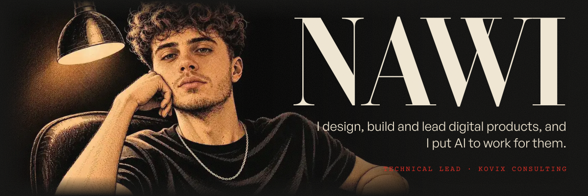
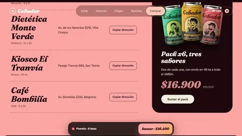
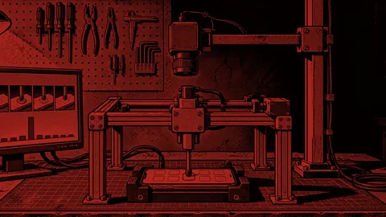

<!-- Rendered by scripts/sync_portfolio.mjs from this template, data/portfolio.json and data/cv.json. Edit those, not README.md. -->

<a href="https://nawi.dev">Portfolio</a> · <a href="https://linkedin.com/in/nahuelmosse">LinkedIn</a> · <a href="mailto:nahuelgamail@gmail.com">Email</a> · <a href="cv/Nahuel-Mosse-CV.pdf">CV (PDF, Spanish)</a>

### At a glance

| | |
|---|---|
| **Role now** | Technical Lead at Kovix Consulting |
| **Target role** | Technical Project Manager |
| **Experience** | 4+ years, since 11/2022 |
| **Based in** | Buenos Aires, Argentina |
| **Languages** | Spanish (native) · English C2 Proficient (EF SET) |
| **Studies** | Analista en Informática · Universidad de Morón · 2025 Ingeniería en Informática · Universidad de Morón · 4th year, in progress |
| **Focus** | I lead teams that ship with AI under human review, and I still write code. |

### Impact

- **Visma:** Azure OpenAI integration cut one onboarding stage from 2 months to 1 week
- **Frávega:** Average receiving time from 7 h 48 min to 46 min (about 90% less)
- **Frávega:** Sellers BFF at 40,000 requests a day; business processes simplified by 80%
- **Jüsto:** 10+ releases, 50% less preparation time, 40 million operations

### Selected work

<table>
  <tr>
    <td width="33%" valign="top"> <b>Grit</b> A local-first training app for Android and iOS, built in Flutter with Riverpod and SQLite.</td>
    <td width="33%" valign="top"> <b>ClubNahuelMosse</b> · <a href="https://github.com/NahuelMosse/ClubNahuelMosse">Repository</a> A Flutter app with a REST API for booking sports courts.</td>
    <td width="33%" valign="top"> <b>Cebador</b> · <a href="https://nahuelmosse.github.io/cebador-landing/">Visit the site</a> The website of a fictional canned yerba mate soda brand, as a design concept.</td>
  </tr>
  <tr>
    <td width="33%" valign="top"> <b>Triaje</b> · <a href="https://nahuelmosse.itch.io/triaje">Play Triaje</a> A browser game about ER triage, published on itch.io.</td>
    <td width="33%" valign="top"> <b>Tools</b>: <a href="https://github.com/NahuelMosse/motion-audit">motion-audit</a> · <a href="https://github.com/NahuelMosse/http-attack">http-attack</a> · <a href="https://github.com/NahuelMosse/migrations-safe">migrations-safe</a> Three npm packages I wrote, each one also a Claude Code skill.</td>
  </tr>
</table>

### Experience

- **Technical Lead at Kovix Consulting**, client engagements: Smart Warehousing (AI Engineering Enablement Lead / SDD Coach, 09/2026–present) · Grupo ST (Technical Lead, 08/2026–present) · Visma (Technical Lead, 01/2026–present)
- **Earlier Kovix engagements:** Frávega (Senior Full Stack Developer, 06/2023–01/2026) · Jüsto (Senior Full Stack Developer, 11/2022–12/2023)

### Stack

**Lead** Technical leadership, Requirements elicitation, Planning, Mentoring, Scrum, Kanban · **AI** Claude Code multi-agent, Spec-Driven Development, Azure OpenAI · **Backend** Node.js, NestJS, TypeScript, PostgreSQL, Prisma, Redis, DDD · **Frontend** React, Next.js, Angular, Tailwind CSS · **Mobile** Flutter, Riverpod, SQLite · **Cloud & QA** Azure, Kubernetes, Terraform, Docker, Playwright, Jest

---

Off duty: CS2, Rocket League, Minecraft, Smite, The Witcher 3, Cyberpunk 2077, chess and Formula 1. · Machine-readable: [portfolio.json](https://nawi.dev/portfolio.json) · [llms.txt](https://nawi.dev/llms.txt)
