<!-- Rendered by scripts/sync_portfolio.mjs from this template and data/. Edit those, not README.md. Every image but the project previews (one animated WebP each, faded to transparent at the edges) comes in a dark and a light variant for the reader's GitHub theme; the ones in assets/live/ are redrawn daily by .github/workflows/profile.yml, the ones in assets/static/ by scripts/build_art.py and build_plates.py, the previews in assets/previews/ by scripts/build_previews.py. -->
<a href="https://nawi.dev"><picture><source media="(prefers-color-scheme: dark)" srcset="assets/static/banner.dark.svg"></picture></a>

<a href="https://nawi.dev"><picture><source media="(prefers-color-scheme: dark)" srcset="assets/static/link-portfolio.dark.svg"></picture></a>
<a href="https://linkedin.com/in/nahuelmosse"><picture><source media="(prefers-color-scheme: dark)" srcset="assets/static/link-linkedin.dark.svg"></picture></a>
<a href="mailto:nahuelgamail@gmail.com"><picture><source media="(prefers-color-scheme: dark)" srcset="assets/static/link-email.dark.svg"></picture></a>
<picture><source media="(prefers-color-scheme: dark)" srcset="assets/live/views.dark.svg"></picture>

<picture><source media="(prefers-color-scheme: dark)" srcset="assets/static/header-projects.dark.svg"></picture>

 
<a href="https://github.com/NahuelMosse/ClubNahuelMosse"><picture><source media="(prefers-color-scheme: dark)" srcset="assets/live/repo-ClubNahuelMosse.dark.svg"></picture></a>
<a href="https://github.com/NahuelMosse/cebador-landing"><picture><source media="(prefers-color-scheme: dark)" srcset="assets/live/repo-cebador-landing.dark.svg"></picture></a>

<a href="https://github.com/NahuelMosse/motion-audit">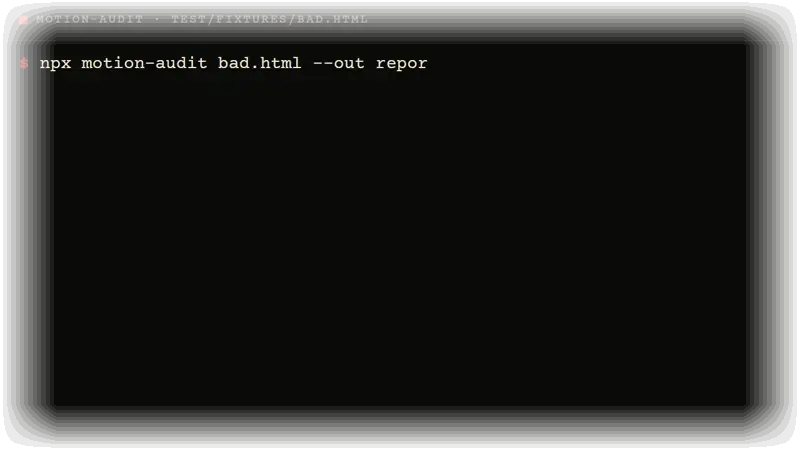</a>
<a href="https://github.com/NahuelMosse/http-attack">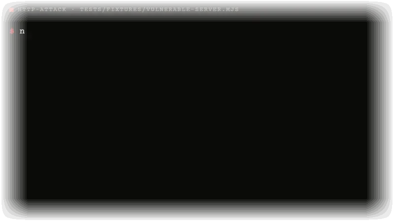</a>
 
<a href="https://github.com/NahuelMosse/motion-audit"><picture><source media="(prefers-color-scheme: dark)" srcset="assets/live/repo-motion-audit.dark.svg"></picture></a>
<a href="https://github.com/NahuelMosse/http-attack"><picture><source media="(prefers-color-scheme: dark)" srcset="assets/live/repo-http-attack.dark.svg"></picture></a>

<a href="https://github.com/NahuelMosse/migrations-safe">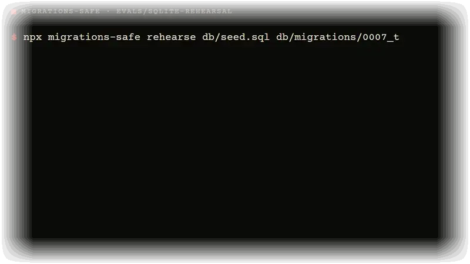</a>

 
<a href="https://github.com/NahuelMosse/migrations-safe"><picture><source media="(prefers-color-scheme: dark)" srcset="assets/live/repo-migrations-safe.dark.svg"></picture></a>
<a href="https://github.com/NahuelMosse/Portfolio"><picture><source media="(prefers-color-scheme: dark)" srcset="assets/live/repo-Portfolio.dark.svg"></picture></a>

<picture><source media="(prefers-color-scheme: dark)" srcset="assets/static/header-npm.dark.svg"></picture>

<picture><source media="(prefers-color-scheme: dark)" srcset="assets/live/npm.dark.svg"></picture>

<a href="https://www.npmjs.com/package/motion-audit"><code>motion-audit</code></a> · <a href="https://www.npmjs.com/package/http-attack"><code>http-attack</code></a> · <a href="https://www.npmjs.com/package/migrations-safe"><code>migrations-safe</code></a>

<picture><source media="(prefers-color-scheme: dark)" srcset="assets/static/header-contributions.dark.svg"></picture>

<picture><source media="(prefers-color-scheme: dark)" srcset="assets/live/skyline.dark.svg"></picture>

<picture><source media="(prefers-color-scheme: dark)" srcset="assets/live/heatmap.dark.svg"></picture>

<picture><source media="(prefers-color-scheme: dark)" srcset="assets/live/streak.dark.svg"></picture>

<picture><source media="(prefers-color-scheme: dark)" srcset="assets/live/building.dark.svg"></picture>
