<!-- Catalog of profile README elements. Every entry below is a candidate; pick the ones that stay. -->

# Profile README catalog

Every element that can go on the profile, rendered with real data and, where the tool allows it, in the portfolio palette (ink `#0c0c0b`, bone `#ede4d0`, red `#d2231b`). Each entry says where it comes from, whether it is self-hosted, what setup it needs and how often it updates.

**Legend.** *Self-hosted:* the image lives in this repo, so no outside service can break it. *External:* the image is served by someone else's server on every view. *Setup:* none, `GITHUB_TOKEN` (the Actions token, already available), a PAT, or an outside account.

---

## Headers and identity

### 01 · Typing terminal hero
Self-made SVG (`scripts/catalog/build_local.mjs`) · self-hosted · setup: none · static, rebuilt by hand


### 02 · readme-kit hero card
[Sagargupta16/readme-kit-action](https://github.com/Sagargupta16/readme-kit-action) · self-hosted · setup: `GITHUB_TOKEN` · regenerated when `catalog/profile.yml` changes


### 03 · readme-typing-svg
[DenverCoder1/readme-typing-svg](https://github.com/DenverCoder1/readme-typing-svg) · external (demolab.com) · setup: none · live


### 04 · Capsule-render header and footer waves
[kyechan99/capsule-render](https://github.com/kyechan99/capsule-render) · external (vercel.app) · setup: none · live


### 05 · Neofetch card
Self-made SVG · self-hosted · setup: none · static, rebuilt by hand

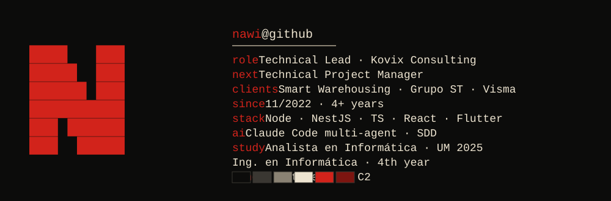

### 06 · About me as a code object
Native Markdown · setup: none · edited by hand

```ts
const nawi = {
  role: "Technical Lead · Kovix Consulting",
  next: "Technical Project Manager",
  clients: ["Smart Warehousing", "Grupo ST", "Visma"],
  base: "Buenos Aires, Argentina",
  languages: { es: "native", en: "C2 (EF SET)" },
  studies: ["Analista en Informática · UM · 2025", "Ingeniería en Informática · 4th year"],
  offDuty: ["CS2", "Rocket League", "chess", "Formula 1"],
};
```

### 07 · readme-kit terminal card
readme-kit-action · self-hosted · setup: `GITHUB_TOKEN` · regenerated when the profile changes


---

## Links and badges

### 08 · Shields badges
[shields.io](https://shields.io) · external · setup: none · live

<p>
<a href="https://nawi.dev"></a>
<a href="https://linkedin.com/in/nahuelmosse"></a>
<a href="mailto:nahuelgamail@gmail.com"></a>
<a href="cv/Nahuel-Mosse-CV.pdf"></a>
</p>

### 09 · npm badges for the tools
shields.io + npm registry · external · setup: none · live

[](https://github.com/NahuelMosse/motion-audit)
[](https://github.com/NahuelMosse/http-attack)
[](https://github.com/NahuelMosse/migrations-safe)


### 10 · readme-kit buttons
readme-kit-action · self-hosted · setup: `GITHUB_TOKEN`

<a href="https://nawi.dev"></a>
<a href="https://linkedin.com/in/nahuelmosse"></a>
<a href="mailto:nahuelgamail@gmail.com"></a>

### 11 · Profile view counter
[antonkomarev/github-profile-views-counter](https://github.com/antonkomarev/github-profile-views-counter) · external (komarev.com) · setup: none · counts every view


### 12 · Contact through an issue form
Native issue form (`.github/ISSUE_TEMPLATE/say-hi.yml`) · setup: none · **works once merged to `master`** (GitHub reads templates from the default branch)

> [!TIP]
> Recruiter or collaborator? [Leave a note](https://github.com/NahuelMosse/NahuelMosse/issues/new?template=say-hi.yml): it takes a minute and I answer every one.

---

## Contributions

### 13 · Contribution snake
[Platane/snk](https://github.com/Platane/snk) · self-hosted via Actions · setup: `GITHUB_TOKEN` · daily


### 14 · Light/dark aware image (`<picture>`)
Native HTML · setup: none · shown here with the snake's GitHub light and dark palettes

<picture>
  <source media="(prefers-color-scheme: dark)" srcset="assets/catalog/gen/snake-dark.svg">
  
</picture>

### 15 · Pac-Man and Breakout contribution graphs
[abozanona/pacman-contribution-graph](https://github.com/abozanona/pacman-contribution-graph) · self-hosted via Actions · setup: `GITHUB_TOKEN` · daily · colors not themable (GitHub dark palette)

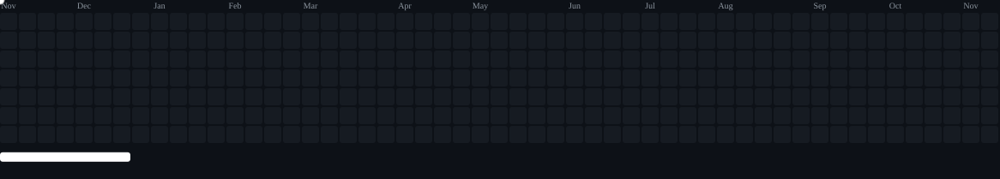

### 16 · 3D contribution skyline
[yoshi389111/github-profile-3d-contrib](https://github.com/yoshi389111/github-profile-3d-contrib) · self-hosted via Actions · setup: `GITHUB_TOKEN` · daily · noir palette from `catalog/3d-noir.json`

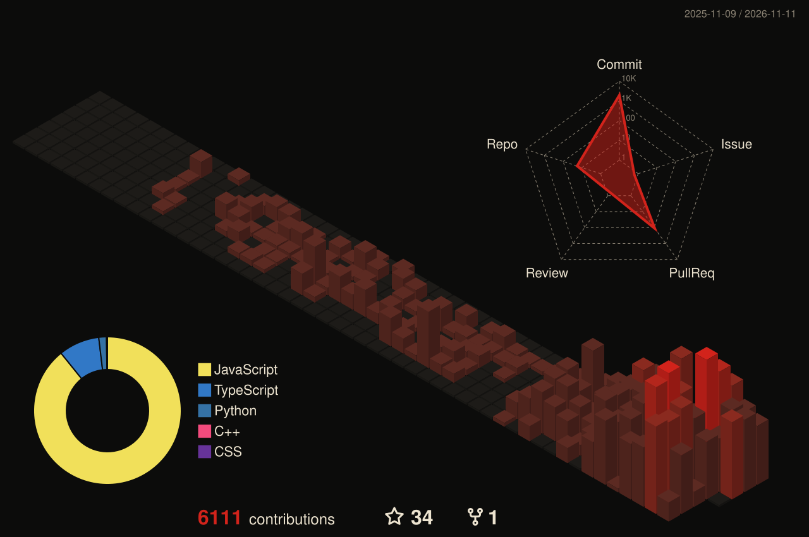

<details><summary>Built-in variants: night rainbow, gitblock</summary>


</details>

### 17 · Isometric calendar (metrics)
[lowlighter/metrics](https://github.com/lowlighter/metrics) `isocalendar` · self-hosted via Actions · setup: `GITHUB_TOKEN` (a PAT adds private activity) · daily


---

## Stats

### 18 · Stats, streak and top languages (self-made)
`scripts/catalog/stats.mjs` · self-hosted via Actions · setup: `GITHUB_TOKEN` · daily

 


### 19 · Profile summary cards
[vn7n24fzkq/github-profile-summary-cards](https://github.com/vn7n24fzkq/github-profile-summary-cards) · self-hosted via Actions · setup: `GITHUB_TOKEN` · daily · fixed themes (here `github_dark`)

  

### 20 · readme-kit stats strip
readme-kit-action · self-hosted · setup: `GITHUB_TOKEN`


### 21 · Metrics plugins: habits, languages, achievements, notable, introduction
lowlighter/metrics · self-hosted via Actions · setup: `GITHUB_TOKEN` (a PAT unlocks private repos and more plugins) · daily


### 22 · Language pie (native Mermaid, live data)
Native Mermaid, data written by `stats.mjs` · setup: `GITHUB_TOKEN` · daily

<!-- live:langs-pie -->
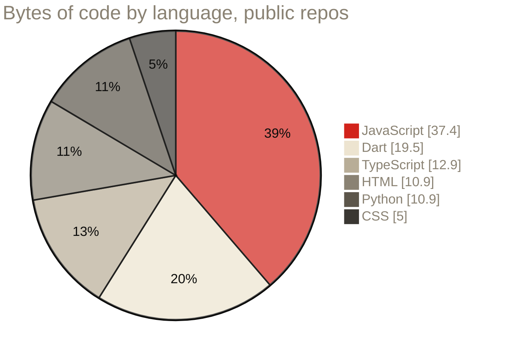
<!-- /live:langs-pie -->

### 23 · Hosted stat cards that are down today
github-readme-stats (`github-readme-stats.vercel.app`, HTTP 503), github-profile-trophy (HTTP 402) and github-readme-activity-graph (HTTP 402) are the classic hosted cards. Their public instances fail today, so they are not rendered here; entries 18–21 cover the same ground without a third party. Streak stats on demolab.com still answers:


---

## Stack

### 24 · Stack icons (self-made)
Self-made SVG from [Simple Icons](https://simpleicons.org) paths · self-hosted · setup: none · static


### 25 · skillicons.dev
[tandpfun/skill-icons](https://github.com/tandpfun/skill-icons) · external · setup: none · colored brand icons, not themable


### 26 · Grouped stack as text
Native Markdown · setup: none

**Lead** Technical leadership · Planning · Mentoring · Scrum · Kanban &nbsp; **AI** Claude Code multi-agent · Spec-Driven Development · Azure OpenAI &nbsp; **Backend** Node.js · NestJS · TypeScript · PostgreSQL · Prisma · Redis · DDD &nbsp; **Frontend** React · Next.js · Angular · Tailwind CSS &nbsp; **Mobile** Flutter · Riverpod · SQLite &nbsp; **Cloud & QA** Azure · Kubernetes · Terraform · Docker · Playwright · Jest

---

## Work and career

### 27 · Animated project preview
Animated WebP cut from the portfolio's Cebador video (`ffmpeg`, 6 s, 640 px, 350 KB) · self-hosted · setup: none · static

<a href="https://nahuelmosse.github.io/cebador-landing/"></a>

### 28 · Project grid with thumbnails
Native HTML table (the current PR #1 layout) · self-hosted · setup: none

<table>
  <tr>
    <td width="33%" valign="top">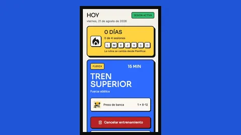<br><b>Grit</b><br><sub>Local-first training app, Flutter + Riverpod + SQLite.</sub></td>
    <td width="33%" valign="top">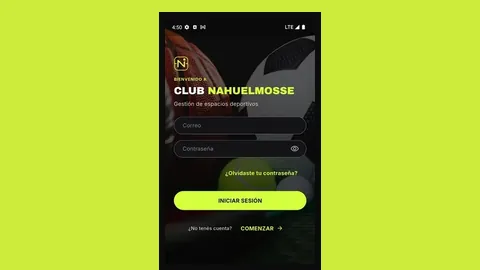<br><b><a href="https://github.com/NahuelMosse/ClubNahuelMosse">ClubNahuelMosse</a></b><br><sub>Flutter app + REST API for booking courts.</sub></td>
    <td width="33%" valign="top">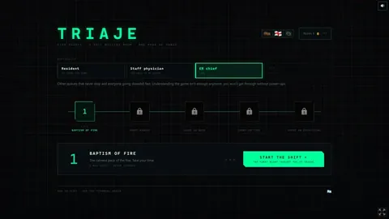<br><b><a href="https://nahuelmosse.itch.io/triaje">Triaje</a></b><br><sub>Browser game about ER triage.</sub></td>
  </tr>
</table>

### 29 · Career timeline (native Mermaid)
Native Mermaid `timeline` · setup: none · edited by hand

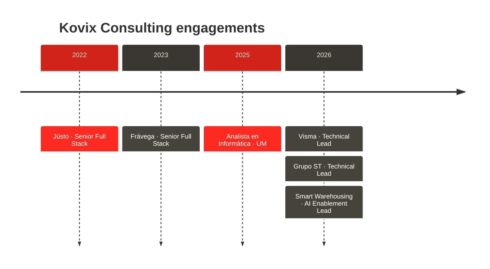

### 30 · readme-kit timeline card
readme-kit-action · self-hosted · setup: `GITHUB_TOKEN`


### 31 · Collapsible sections (`<details>`)
Native HTML · setup: none · keeps the page short and the depth one click away

<details><summary><b>Impact, with numbers</b></summary>

- **Visma:** Azure OpenAI integration cut one onboarding stage from 2 months to 1 week
- **Frávega:** average receiving time from 7 h 48 min to 46 min (about 90% less)
- **Frávega:** sellers BFF at 40,000 requests a day; business processes simplified by 80%
- **Jüsto:** 10+ releases, 50% less preparation time, 40 million operations
</details>

<details><summary><b>Experience</b></summary>

- **Technical Lead at Kovix Consulting**, engagements: Smart Warehousing (AI Engineering Enablement Lead / SDD Coach, 09/2026–present) · Grupo ST (Technical Lead, 08/2026–present) · Visma (Technical Lead, 01/2026–present)
- **Earlier engagements:** Frávega (Senior Full Stack Developer, 06/2023–01/2026) · Jüsto (Senior Full Stack Developer, 11/2022–12/2023)
</details>

### 32 · GitHub alerts as callouts
Native Markdown · setup: none

> [!NOTE]
> Open to Technical Lead and Technical Project Manager roles. Based in Buenos Aires.

> [!IMPORTANT]
> I lead teams that ship with AI under human review, and I still write code.

---

## Live activity

### 33 · Recently on GitHub (auto-updated list)
`stats.mjs` from the public events API · self-hosted · setup: `GITHUB_TOKEN` · daily

<!-- live:activity -->
- 2026-11-10 · Opened PR [#42](https://github.com/NahuelMosse/ClubNahuelMosse/pull/42) in [NahuelMosse/ClubNahuelMosse](https://github.com/NahuelMosse/ClubNahuelMosse): ENG-23 · los nombres del código y la configuración en inglés
- 2026-11-10 · Opened PR [#1](https://github.com/NahuelMosse/Portfolio/pull/1) in [NahuelMosse/Portfolio](https://github.com/NahuelMosse/Portfolio): PF-1 · Cinematic portfolio
- 2026-11-10 · Opened PR [#41](https://github.com/NahuelMosse/ClubNahuelMosse/pull/41) in [NahuelMosse/ClubNahuelMosse](https://github.com/NahuelMosse/ClubNahuelMosse): KIT-08: el repo usa el kit 6.45.3
- 2026-11-09 · Opened PR [#1](https://github.com/NahuelMosse/NahuelMosse/pull/1) in [NahuelMosse/NahuelMosse](https://github.com/NahuelMosse/NahuelMosse): Noir case-file profile README matching the portfolio
- 2026-11-08 · Opened PR [#3](https://github.com/NahuelMosse/moonlight-common-c/pull/3) in [NahuelMosse/moonlight-common-c](https://github.com/NahuelMosse/moonlight-common-c): Use kernel receive timestamps for video packets
- 2026-11-08 · Opened PR [#15](https://github.com/NahuelMosse/http-attack/pull/15) in [NahuelMosse/http-attack](https://github.com/NahuelMosse/http-attack): fix: reset the connection only when a cut body has not been written yet
<!-- /live:activity -->

### 34 · WakaTime coding time
[athul/waka-readme](https://github.com/athul/waka-readme) or [anmol098/waka-readme-stats](https://github.com/anmol098/waka-readme-stats) · Action writes text into the README · **needs setup: a WakaTime account + `WAKATIME_API_KEY` secret** · daily. Sample of the format, not real data:

```text
TypeScript   12 hrs 40 mins  ████████████▓░░░░░░░░░░░░   48.1 %
Dart          6 hrs 05 mins  ██████░░░░░░░░░░░░░░░░░░░   23.1 %
Markdown      3 hrs 12 mins  ███░░░░░░░░░░░░░░░░░░░░░░   12.2 %
```

### 35 · Spotify now playing
[kittinan/spotify-github-profile](https://github.com/kittinan/spotify-github-profile) · external · **needs setup: Spotify login on their service** · live. Tool's own sample, not real data:


### 36 · Community chess (issue-driven game)
Pattern popularized by [timburgan](https://github.com/timburgan/timburgan): visitors open an issue with a move, an Action validates it and redraws the board · **needs a workflow on `master` and moderation** · preview only:

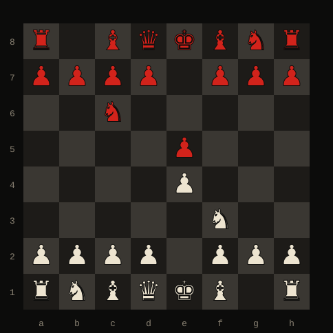

---


<sub>Courier Prime is used under the SIL Open Font License (`fonts/OFL-CourierPrime.txt`).</sub>
