<!-- Rendered by scripts/sync_portfolio.mjs from this template and data/. Edit those, not README.md. The images in assets/live/ are redrawn daily by .github/workflows/profile.yml; the ones in assets/static/ and assets/cards/ by scripts/build_*.py and build_icons.mjs. -->
<a href="https://nawi.dev">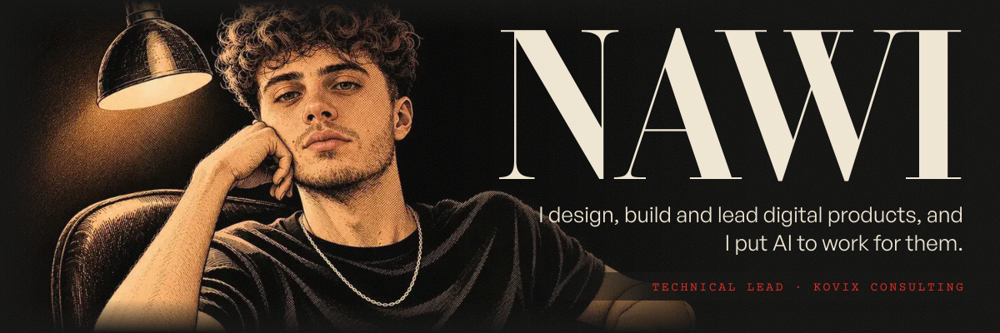</a>

<table>
  <tr>
    <td width="50%"><a href="https://github.com/NahuelMosse/ClubNahuelMosse"></a></td>
    <td width="50%"><a href="https://github.com/NahuelMosse/cebador-landing"></a></td>
  </tr>
  <tr>
    <td width="50%"><a href="https://github.com/NahuelMosse/motion-audit"></a></td>
    <td width="50%"><a href="https://github.com/NahuelMosse/http-attack"></a></td>
  </tr>
  <tr>
    <td width="50%"><a href="https://github.com/NahuelMosse/migrations-safe"></a></td>
    <td width="50%"><a href="https://github.com/NahuelMosse/Portfolio"></a></td>
  </tr>
</table>









