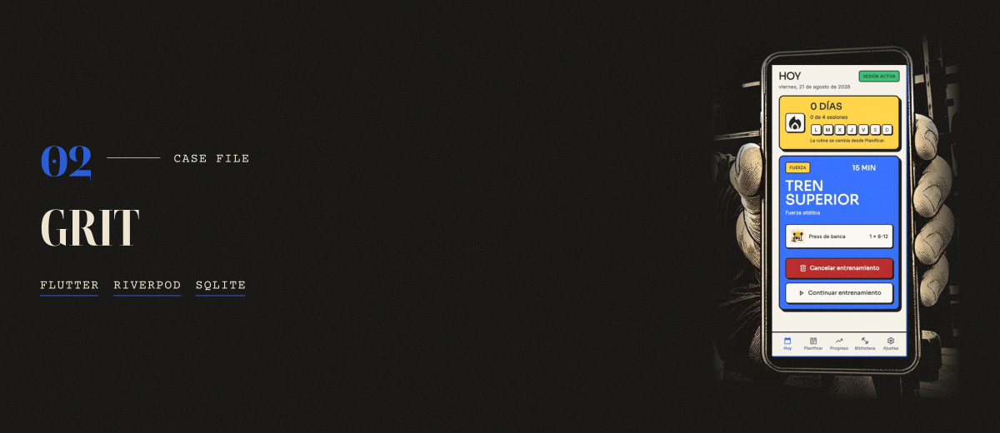
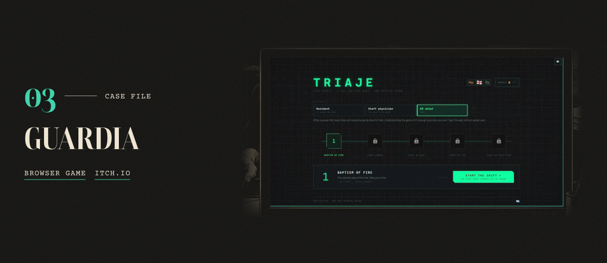
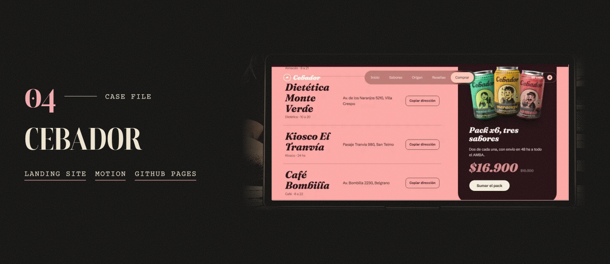
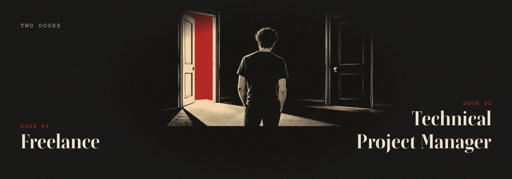

<a href="https://nahuelmosse.vercel.app">
  
</a>

<p align="center">
  <a href="https://nahuelmosse.vercel.app"><code>PORTFOLIO</code></a> &nbsp;·&nbsp;
  <a href="https://linkedin.com/in/nahuelmosse"><code>LINKEDIN</code></a> &nbsp;·&nbsp;
  <a href="mailto:nahuelgamail@gmail.com"><code>NAHUELGAMAIL@GMAIL.COM</code></a>
</p>



<br>



**What.** A development kit where the requirement is frozen as a card and every behavior is proven by tests tagged to it.<br>
**Problem.** Work built with AI agents drifts from what was asked, and nobody can tell which part was verified.<br>
**Role.** I designed the method, the guards and the tools, and published the skills that stand alone.

Claude Code agents build each card; hooks and tests keep them honest. The skills: [motion-audit](https://github.com/NahuelMosse/motion-audit) · [http-attack](https://github.com/NahuelMosse/http-attack) · [migrations-safe](https://github.com/NahuelMosse/migrations-safe)

<br>



**What.** A local-first training app for Android and iOS, built in Flutter with Riverpod and SQLite.<br>
**Problem.** Training logs need to work in a gym with no signal and still feel instant.<br>
**Role.** I rebuilt it from its specs, end to end: product, design lab and code.

Specified with Spec Kit; AI agents wrote the code against the specs.

<br>



**What.** A triage game for the browser, published as Triaje.<br>
**Problem.** Deciding who is treated first under pressure is hard to explain and easy to play.<br>
**Role.** I designed the rules and built the game.

Built with Claude Code; its trailers and ads made with AI. [Play Triaje →](https://nahuelmosse.itch.io/triaje)

<br>



**What.** The site of a fictional canned mate soda brand, a design piece.<br>
**Problem.** A new brand needs an identity that is felt before it is read.<br>
**Role.** I did the art direction, the motion and the code.

Built with my dev kit: Claude Code agents, every behavior tested. [Visit the site →](https://nahuelmosse.github.io/cebador-landing/)

<br>



**What.** A Flutter app with a REST API to book sports courts.<br>
**Problem.** Reserving a court by message is slow and double reservations happen.<br>
**Role.** I built the app and the API.

Built with my dev kit: specs first, then Claude Code agents. [Repository →](https://github.com/NahuelMosse/ClubNahuelMosse)

<br>

## Record

 **Kovix Consulting** · Technical Lead · now

| Assigned to | Role | Period |
|---|---|---|
| **Smart Warehousing** | AI Engineering Enablement Lead / SDD Coach | 09/2026 – present |
| **Grupo ST** | Technical Lead | 08/2026 – present |
|  **Visma** | Technical Lead | 01/2026 – present |

| Earlier | Role | Period |
|---|---|---|
|  **Frávega** | Senior Full Stack Developer | 06/2023 – 01/2026 |
|  **Jüsto** | Senior Full Stack Developer | 11/2022 – 12/2023 |

- **Smart Warehousing.** A set of warehouse teams adopting AI-assisted development, each using agents its own way. I lead the engineering enablement: the method, the training and the coaching of the teams.
- **Grupo ST.** An AI-first delivery on a credit risk platform that manages documents and decisions. As technical lead I set the architecture and run the delivery with specifications and tests.
- **Visma.** A payroll onboarding product for a Nordic software company. I am the customer's technical contact: scope, architecture, security, cloud and mentoring.
- **Frávega.** The warehouse system of a large retailer's online orders. I built the order flow and the seller interface, and planned the critical releases.
- **Jüsto.** A multi-warehouse system for an online supermarket. I designed the system, coordinated the team and kept it steady through the sales peaks.

```
Frávega · receiving flow      7h 48m  ──▶  46m average
Frávega · BFF for Sellers     40k requests/day · 1.2M/month
Frávega · process redesign    ~80% fewer manual steps
Jüsto   · releases            10+ to production, no major incidents
```

<br>



<table>
  <tr>
    <td width="50%" valign="top">
      <code>DOOR 01</code><br>
      <b>Freelance</b><br><br>
      Freelance builds of digital products and sites with a visual identity of their own, from design to launch. I build the whole product myself, design, code and launch, and the pieces above are what I already built.<br><br>
      <a href="mailto:nahuelgamail@gmail.com?subject=Freelance%20project%20%C2%B7%20Nahuel%20Mosse&body=1.%20What%20are%20you%20building%2C%20and%20for%20whom%3F%0A2.%20What%20should%20it%20look%20and%20feel%20like%3F%0A3.%20When%20do%20you%20need%20the%20first%20version%3F">Hire me for a project →</a>
    </td>
    <td width="50%" valign="top">
      <code>DOOR 02</code><br>
      <b>Technical Project Manager</b><br><br>
      For companies: Technical Project Manager of teams that deliver with AI under human review, led by someone who still codes. AI-first delivery: Spec-Driven Development, agents orchestrated with Claude Code, every requirement traced to a test and reviewed by a person on each pull request.<br><br>
      <a href="mailto:nahuelgamail@gmail.com?subject=Technical%20Project%20Manager%20role%20%C2%B7%20Nahuel%20Mosse&body=1.%20What%20does%20your%20team%20deliver%20today%3F%0A2.%20Where%20does%20delivery%20slow%20down%3F%0A3.%20Who%20reviews%20the%20AI-assisted%20work%3F">Bring AI-first delivery to your team →</a>
    </td>
  </tr>
</table>

<br>



<br>

> Off duty: CS2, Rocket League, Minecraft, Smite, The Witcher 3, Cyberpunk 2077, chess and Formula 1.

<sub>Machine-readable: [portfolio.json](https://nahuelmosse.vercel.app/portfolio.json) for structured parsing, [llms.txt](https://nahuelmosse.vercel.app/llms.txt) if you're an agent reading this on someone's behalf. Set in Boska and General Sans by Indian Type Foundry (Fontshare) and Courier Prime by The Courier Prime Project Authors (SIL OFL).</sub>
