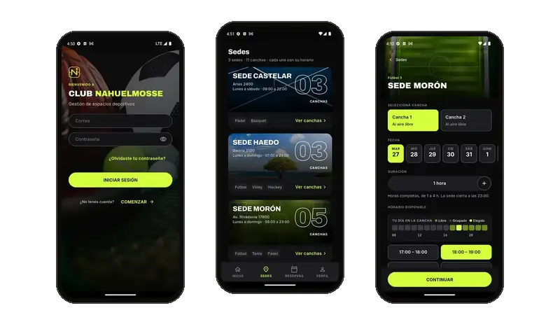
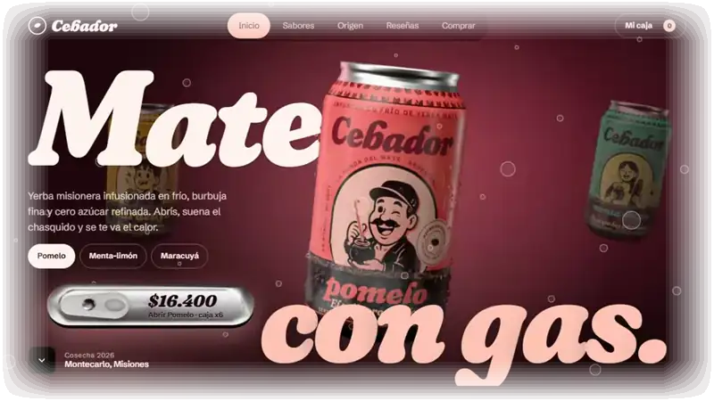
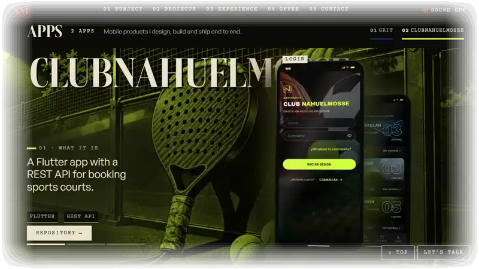

<!-- Rendered by scripts/sync_portfolio.mjs from this template and data/. Edit those, not README.md. Every image but the project previews (one animated WebP each, faded to transparent at the edges) comes in a dark and a light variant for the reader's GitHub theme. The live widgets, the views chip among them, are drawn on each request at lab.nawi.dev/api/profile (NahuelMosse/profile-widgets); the ones in assets/static/ by scripts/build_art.py and build_plates.py; the previews in assets/previews/ by scripts/build_previews.py. -->
<a href="https://nawi.dev"><picture><source media="(prefers-color-scheme: dark)" srcset="assets/static/banner.dark.svg"></picture></a>

<a href="https://nawi.dev"><picture><source media="(prefers-color-scheme: dark)" srcset="assets/static/link-portfolio.dark.svg"></picture></a><a href="https://linkedin.com/in/nahuelmosse"><picture><source media="(prefers-color-scheme: dark)" srcset="assets/static/link-linkedin.dark.svg"></picture></a><a href="mailto:contact@nahuelmosse.com"><picture><source media="(prefers-color-scheme: dark)" srcset="assets/static/link-email.dark.svg"></picture></a><picture><source media="(prefers-color-scheme: dark)" srcset="https://lab.nawi.dev/api/profile/views.svg?theme=dark"></picture>

<picture><source media="(prefers-color-scheme: dark)" srcset="assets/static/header-projects.dark.svg"></picture>

 
<a href="https://github.com/NahuelMosse/ClubNahuelMosse"><picture><source media="(prefers-color-scheme: dark)" srcset="https://lab.nawi.dev/api/profile/repo-ClubNahuelMosse.svg?theme=dark"></picture></a><a href="https://github.com/NahuelMosse/cebador-landing"><picture><source media="(prefers-color-scheme: dark)" srcset="https://lab.nawi.dev/api/profile/repo-cebador-landing.svg?theme=dark"></picture></a><a href="https://github.com/NahuelMosse/Portfolio"><picture><source media="(prefers-color-scheme: dark)" srcset="https://lab.nawi.dev/api/profile/repo-Portfolio.svg?theme=dark"></picture></a>

<a href="https://github.com/NahuelMosse/motion-audit"><picture><source media="(prefers-color-scheme: dark)" srcset="https://lab.nawi.dev/api/profile/tool-motion-audit.svg?theme=dark"></picture></a><a href="https://github.com/NahuelMosse/http-attack"><picture><source media="(prefers-color-scheme: dark)" srcset="https://lab.nawi.dev/api/profile/tool-http-attack.svg?theme=dark"></picture></a><a href="https://github.com/NahuelMosse/migrations-safe"><picture><source media="(prefers-color-scheme: dark)" srcset="https://lab.nawi.dev/api/profile/tool-migrations-safe.svg?theme=dark"></picture></a>

<picture><source media="(prefers-color-scheme: dark)" srcset="assets/static/header-npm.dark.svg"></picture>

<a href="https://www.npmjs.com/~nahuelmosse"><picture><source media="(prefers-color-scheme: dark)" srcset="https://lab.nawi.dev/api/profile/npm.svg?theme=dark"></picture></a>

<a href="https://www.npmjs.com/package/motion-audit"><picture><source media="(prefers-color-scheme: dark)" srcset="https://lab.nawi.dev/api/profile/npm-motion-audit.svg?theme=dark"></picture></a><a href="https://www.npmjs.com/package/http-attack"><picture><source media="(prefers-color-scheme: dark)" srcset="https://lab.nawi.dev/api/profile/npm-http-attack.svg?theme=dark"></picture></a><a href="https://www.npmjs.com/package/migrations-safe"><picture><source media="(prefers-color-scheme: dark)" srcset="https://lab.nawi.dev/api/profile/npm-migrations-safe.svg?theme=dark"></picture></a>

<picture><source media="(prefers-color-scheme: dark)" srcset="assets/static/header-contributions.dark.svg"></picture>

<picture><source media="(prefers-color-scheme: dark)" srcset="https://lab.nawi.dev/api/profile/skyline.svg?theme=dark"></picture>

<picture><source media="(prefers-color-scheme: dark)" srcset="https://lab.nawi.dev/api/profile/heatmap.svg?theme=dark"></picture>

<picture><source media="(prefers-color-scheme: dark)" srcset="https://lab.nawi.dev/api/profile/streak.svg?theme=dark"></picture>

<picture><source media="(prefers-color-scheme: dark)" srcset="https://lab.nawi.dev/api/profile/building.svg?theme=dark"></picture>
