<!-- Catalog of profile README elements. Every entry below is a candidate; pick the ones that stay. -->

# Profile README catalog

Graphic candidates for the profile, rendered with real data in the portfolio palette (ink `#0c0c0b`, bone `#ede4d0`, red `#d2231b`) and its fonts (Boska, General Sans, Courier Prime). Each entry gives its source, whether it is self-hosted or external, the setup it needs and how often it updates.

*Self-hosted:* the file lives in this repo, so no outside service can break it. *External:* someone else's server serves it on every view. *Live:* the `Catalog widgets` workflow redraws it daily with the Actions `GITHUB_TOKEN`. *Static:* rebuilt by hand with `scripts/catalog/build_noir.py` or `build_local.mjs`.

---

## Identity

### 01 · Typing terminal hero
Self-made SVG (`build_local.mjs`) · self-hosted · setup: none · static

### 02 · Animated signature
Self-made SVG, Boska outlines drawn stroke by stroke, then inked (`build_noir.py`) · self-hosted · setup: none · static


### 03 · Poster banner
The PR #1 banner: cover illustration, NAWI and the promise line (`scripts/build_art.py`) · self-hosted · setup: none · static

### 04 · readme-kit hero card
[Sagargupta16/readme-kit-action](https://github.com/Sagargupta16/readme-kit-action) · self-hosted · setup: `GITHUB_TOKEN` · regenerated when `catalog/profile.yml` changes · only the accent is themable

### 05 · Capsule-render header wave
[kyechan99/capsule-render](https://github.com/kyechan99/capsule-render) · external (vercel.app) · setup: none · live

### 06 · At a glance, as tiles
Self-made SVG (`build_noir.py`) · self-hosted · setup: none · static


---

## Links and contact

### 07 · Noir badges
[shields.io](https://shields.io) · external · setup: none · live

### 08 · readme-kit buttons
readme-kit-action · self-hosted · setup: `GITHUB_TOKEN`

### 09 · Contact form button
Native issue form (`.github/ISSUE_TEMPLATE/say-hi.yml`) behind a noir badge · setup: none · the form works once merged to `master`

---

## Section design

### 10 · Chapter headers
Self-made SVG, the portfolio's chapter style: red numeral line, Boska word, red thread (`build_noir.py`) · self-hosted · setup: none · static



### 11 · Red-thread divider
Self-made SVG, animated thread with a knot (`build_noir.py`) · self-hosted · setup: none · static


---

## Contributions

### 12 · Contribution snake (noir)
[Platane/snk](https://github.com/Platane/snk) · self-hosted · setup: `GITHUB_TOKEN` · live

### 13 · 3D contribution skyline (noir)
[yoshi389111/github-profile-3d-contrib](https://github.com/yoshi389111/github-profile-3d-contrib) with `catalog/3d-noir.json` · self-hosted · setup: `GITHUB_TOKEN` · live

### 14 · Contribution heatmap in red
Self-made (`stats.mjs`), log-scaled red cells that fade in week by week · self-hosted · setup: `GITHUB_TOKEN` · live

### 15 · Weekly activity
Self-made (`stats.mjs`), 52-week area chart with the line drawn in and the peak marked · self-hosted · setup: `GITHUB_TOKEN` · live


### 16 · Commit clock
Self-made (`stats.mjs`), commits by hour in Buenos Aires time across public repos · self-hosted · setup: `GITHUB_TOKEN` · live


---

## Stats

### 17 · Stats card
Self-made (`stats.mjs`) · self-hosted · setup: `GITHUB_TOKEN` · live

### 18 · Streak with flame
Self-made (`stats.mjs`) · self-hosted · setup: `GITHUB_TOKEN` · live

<table><tr>
<td> 17</td>
<td> 18</td>
</tr></table>

### 19 · Top languages, bar
Self-made (`stats.mjs`) · self-hosted · setup: `GITHUB_TOKEN` · live

### 20 · Language donut
Self-made (`stats.mjs`) · self-hosted · setup: `GITHUB_TOKEN` · live

<table><tr>
<td> 19</td>
<td> 20</td>
</tr></table>

### 21 · Language pie (native Mermaid)
Native Mermaid with live data from `stats.mjs` · setup: `GITHUB_TOKEN` · live

<!-- live:langs-pie -->
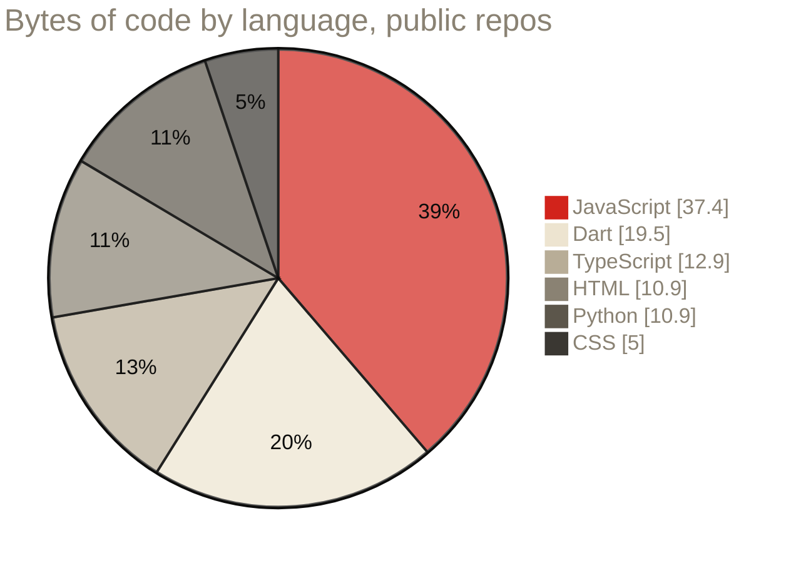
<!-- /live:langs-pie -->

### 22 · Contribution radar
Self-made (`stats.mjs`), commits, PRs, reviews, issues and new repos on a log scale · self-hosted · setup: `GITHUB_TOKEN` · live


### 23 · Milestone badges
Self-made (`stats.mjs`), live counts in hexagon badges. GitHub's own achievements have no API, so these use real figures instead · self-hosted · setup: `GITHUB_TOKEN` · live


---

## Stack

### 24 · Stack icons
Self-made SVG from [Simple Icons](https://simpleicons.org) paths (`build_local.mjs`) · self-hosted · setup: none · static

---

## Work

### 25 · Animated device mockups
Real screens from the portfolio in a bone device frame with a red tab, crossfading (`build_noir.py`, animated WebP) · self-hosted · setup: none · static · **the Grit, Club, Cebador and Triaje screens show those products' own Spanish UI; only the dev-kit pages are in English**

<table><tr>
<td width="25%">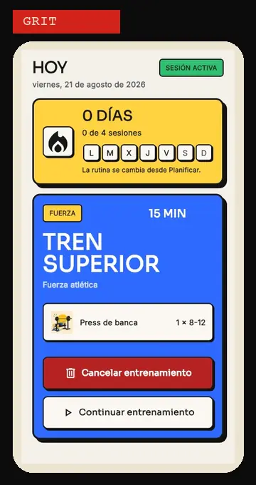</td>
<td width="25%">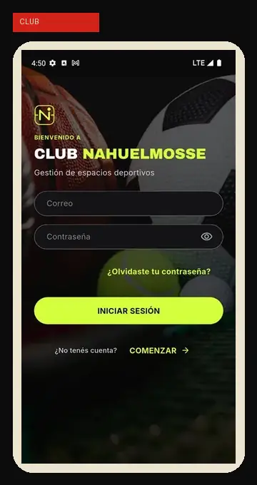</td>
<td width="50%">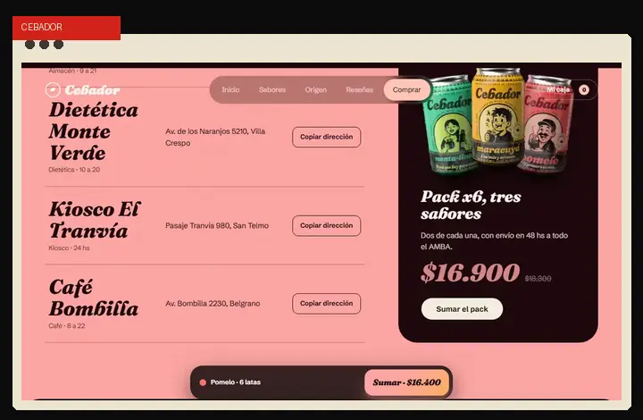 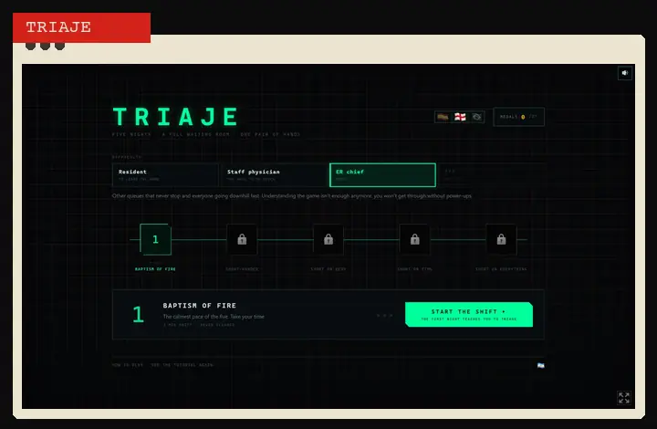</td>
</tr><tr>
<td colspan="3">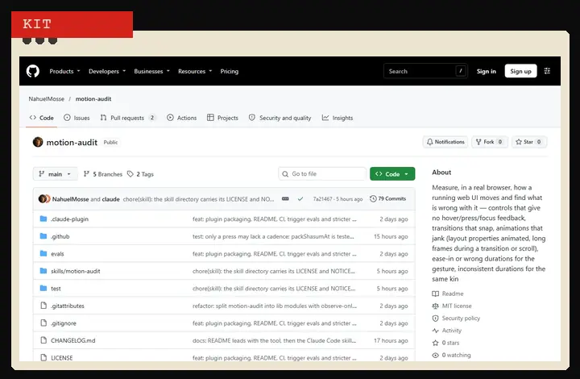</td>
</tr></table>

### 26 · Animated project preview
Animated WebP cut from the portfolio's Cebador video (`ffmpeg`) · self-hosted · setup: none · static · **the site's copy is Spanish**

### 27 · Project grid with thumbnails
HTML table with the PR #1 thumbnails · self-hosted · setup: none · static · **the app screens are in Spanish**

<table>
  <tr>
    <td width="33%" valign="top"> <b>Grit</b></td>
    <td width="33%" valign="top"> <b><a href="https://github.com/NahuelMosse/ClubNahuelMosse">ClubNahuelMosse</a></b></td>
    <td width="33%" valign="top"> <b><a href="https://nahuelmosse.itch.io/triaje">Triaje</a></b></td>
  </tr>
</table>

### 28 · Noir repo cards
Self-made (`stats.mjs`), live stars, language and last push; descriptions from the English overrides in `catalog/profile.yml` · self-hosted · setup: `GITHUB_TOKEN` · live

<table><tr>
<td><a href="https://github.com/NahuelMosse/ClubNahuelMosse"></a></td>
<td><a href="https://github.com/NahuelMosse/cebador-landing"></a></td>
</tr><tr>
<td><a href="https://github.com/NahuelMosse/motion-audit"></a></td>
<td><a href="https://github.com/NahuelMosse/http-attack"></a></td>
</tr><tr>
<td><a href="https://github.com/NahuelMosse/migrations-safe"></a></td>
<td><a href="https://github.com/NahuelMosse/Portfolio"></a></td>
</tr></table>

### 29 · npm downloads for the dev-kit tools
Self-made (`stats.mjs`) from the npm registry and downloads API · self-hosted · setup: none · live


### 30 · Currently building
Self-made (`stats.mjs`): the most recently pushed public repo with an English description in `catalog/profile.yml`, and its latest pull-request activity; raw PR titles are never shown · self-hosted · setup: `GITHUB_TOKEN` · live


---

## Career

### 31 · Impact in big numbers
Self-made SVG, Boska numerals from the CV's results (`build_noir.py`) · self-hosted · setup: none · static


### 32 · Career timeline, graphic
Self-made SVG: Kovix engagements in red, studies in bone, the thread drawn in (`build_noir.py`) · self-hosted · setup: none · static


### 33 · readme-kit timeline card
readme-kit-action · self-hosted · setup: `GITHUB_TOKEN` · only the accent is themable

### 34 · Career timeline (native Mermaid)
Native Mermaid `timeline` · setup: none · edited by hand

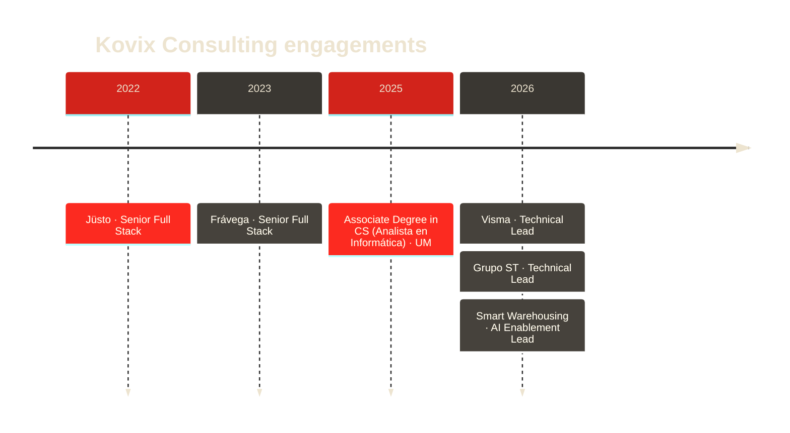

### 35 · Studies and certifications
Self-made SVG cards with the university and institute logos; each degree shows its English name over the legal Spanish title (`build_noir.py`) · self-hosted · setup: none · static


### 36 · Working-hours overlap
Self-made SVG: Buenos Aires hours against US and European hubs, in standard time (`build_noir.py`) · self-hosted · setup: none · static


---

## Footer

### 37 · Animated footer
Self-made SVG: red thread, signature drawn in, contact line (`build_noir.py`) · self-hosted · setup: none · static


---

## Round 3 candidates

Built to fill gaps in the PR #1 composition; not in that README yet.

### 38 · Selected impact by engagement
Self-made SVG: per role, a red bar shrinks from the before value to the result, or grows to it (`build_noir.py`) · self-hosted · setup: none · static


### 39 · Project spotlight
Animated WebP: the project's name, line and stack beside its real screens crossfading in the bone phone frame with a red tab (`build_noir.py`) · self-hosted · setup: none · static · **Grit's screens show the app's own Spanish UI**

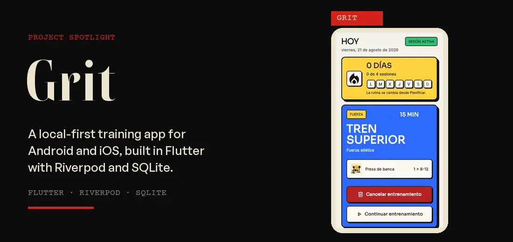

### 40 · Open to TPM roles
Self-made SVG call to action: red panel, pulsing status dot, the TPM offer line; the whole card links to a prefilled email (`build_noir.py`) · self-hosted · setup: none · static

<a href="mailto:nahuelgamail@gmail.com?subject=Technical%20Project%20Manager%20role%20%C2%B7%20Nahuel%20Mosse"></a>

### 41 · How I deliver
Self-made SVG: the TPM offer's four steps (spec, agents, tests, review) on a red thread (`build_noir.py`) · self-hosted · setup: none · static


### 42 · Closing contact card
Self-made SVG: Boska line over the three channels as tiles; links to the portfolio (`build_noir.py`) · self-hosted · setup: none · static

<a href="https://nawi.dev"></a>

Courier Prime is used under the SIL Open Font License (`fonts/OFL-CourierPrime.txt`). Boska and General Sans appear only as outlines.
